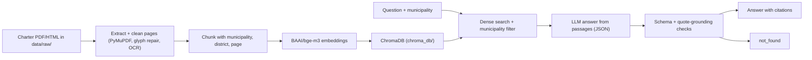

# Khula Gyan: Palika Guide

[](LICENSE) 

Palika Guide answers questions about Nepali **municipal services** (birth and death registration, recommendations, business registration, fees, time limits, responsible office) from each municipality's citizen charter (नागरिक बडापत्र), in Nepali or English. Every answer cites the document and page it came from. When the charter does not support an answer, or the question's municipality has no indexed charter, it returns `not_found` instead of guessing or using another municipality's charter. It is a retrieval-augmented generation (RAG) prototype built during a student hackathon (October 2026); the repository is named Khula Gyan.

[](https://youtu.be/-JgkMY7osqQ)

> **Read this first:** the municipal charters used during development are **not** in this repository (no reuse permission yet). A fresh clone installs, passes its tests and runs the UI, but answers `not_found` until you add documents you are allowed to use. See [Data: use your own documents](#data-use-your-own-documents).

## Features

- **Cited answers.** Every answer has `citations[{source, page, quote}]`, and each quote must appear word for word in a retrieved passage (`src/generation/guard.py`). If it doesn't, the answer is refused.
- **`not_found` refusal.** The app refuses when retrieval scores are below `guard_min_score`, when the model output is invalid or uncited, when a quote is not grounded, or when the LLM call fails.
- **Municipality filter and wrong-municipality guard.** With a municipality selected, search returns only that municipality's chunks. Without one, `ask()` tries to find a municipality name in the question and otherwise asks the user to pick one.
- **Nepali and English.** Questions can be in Nepali, English or a mix (language is detected). Municipality names are recognised in romanized and Devanagari spelling, including case suffixes (for example "ललितपुरमा"). All Nepali text comparisons use Unicode NFC.
- **Document repair.** PDF/HTML extraction keeps page numbers, repairs broken Devanagari glyph maps (Kalimati subsets), converts legacy Preeti/Kantipur text to Unicode, and can OCR scanned pages with Tesseract (`nep+eng`).
- **Evaluation harness.** `eval/run_eval.py` reports hit@5, citation accuracy, correctness, correct refusal, false refusal and p95 latency over human-verified questions.
- **Spend cap.** Each process reserves a cost estimate before every API call and stops before sending if `MAX_API_SPEND_USD` would be exceeded. Real calls are blocked until per-token rates are set.
- **Fixed response contract.** Every response matches [docs/ask-response.schema.json](docs/ask-response.schema.json) (see [docs/response-contract.md](docs/response-contract.md)).

## How it works



Code path: `src/ingest/` → `scripts/build_index.py` → `src/retrieval/search.py` → `src/generation/answer.py` → `src/pipeline.py` `ask()` → `frontend/app.py`. The search `score` is cosine similarity mapped to 0–1. It is not a probability.

## Tech stack

Python 3.12 · PyMuPDF and fontTools (extraction, glyph repair) · Tesseract via pytesseract (optional OCR) · sentence-transformers with `BAAI/bge-m3` · ChromaDB · OpenAI Python client for any OpenAI-compatible chat API · Streamlit · pytest. Exact versions are pinned in [requirements.txt](requirements.txt). CPU-only PyTorch is installed first.

## Prerequisites

- **Python 3.12** and Git.
- **GNU Make** (optional). Every Make target has a plain command shown below.
- **About 2.5 GB of free disk space and network access** for the `BAAI/bge-m3` model, which Hugging Face downloads on first index or search. PyTorch and the other dependencies need more space on top of that.
- **Tesseract OCR** with `nep` and `eng` language data (optional). Only needed for scanned PDF pages. It must be on `PATH` (`tesseract --list-langs`).
- **An API key for any OpenAI-compatible LLM provider**, or `LLM_PROVIDER=fake` to run everything with no key. Fake answers are deliberately nonsense and only test the plumbing.

## Setup

Run all commands from the repository root.

```bash
git clone https://github.com/HAliveKP/Khula-Gyan.git
cd Khula-Gyan
```

### Option A: Make

```bash
make setup     # creates .venv, installs CPU-only torch, then requirements.txt
```

The Makefile calls `py -3.12` on Windows and `python3.12` elsewhere. `py -3.12` works only if Python came from the python.org Windows installer. If it reports "No runtime installed that matches 3.12" (for example, Python installed with uv), pass the interpreter explicitly:

```bash
make setup PYTHON=python3.12     # or PYTHON=python if `python --version` shows 3.12.x
```

### Option B: Plain commands

Check `python --version` (or `python3.12 --version`) shows 3.12.x first.

Windows (Git Bash):

```bash
python -m venv .venv                 # or: py -3.12 -m venv .venv  /  uv venv --python 3.12 .venv
source .venv/Scripts/activate
python -m pip install --upgrade pip
python -m pip install torch==2.14.1 --index-url https://download.pytorch.org/whl/cpu
python -m pip install -r requirements.txt
```

macOS / Linux:

```bash
python3.12 -m venv .venv             # or: uv venv --python 3.12 .venv
source .venv/bin/activate
python -m pip install --upgrade pip
python -m pip install torch==2.14.1 --index-url https://download.pytorch.org/whl/cpu
python -m pip install -r requirements.txt
```

If you create the venv with uv, it may not include pip. Install with `uv pip install ...` instead, or run `python -m ensurepip` first.

### Configure

```bash
cp .env.example .env
```

Edit `.env` (never commit it). Either set `LLM_PROVIDER=fake` for a key-free trial, or set `LLM_MODEL`, `LLM_API_KEYS`, `LLM_BASE_URL` and both cost rates for a real provider (see [Environment variables](#environment-variables)). Then check the setup:

```bash
python scripts/smoke_test_embedding.py   # downloads bge-m3 on first run; checks 1024-dim vectors
python scripts/smoke_test_llm.py         # real provider only: a "Say ok" call per key, then 2 short questions
```

### Run

```bash
make run                         # or: python -m streamlit run frontend/app.py
```

Pick a municipality, keep the service on "Palika Guide", and ask a question. Without an index, every question returns `not_found`.

## Usage

- **UI:** `frontend/app.py` shows the answer, a checklist (documents, fees, steps, where), citations with quotes, confidence and a disclaimer.
- **Python:**
  ```python
  from src.pipeline import ask
  ask("पोखरामा जन्म दर्ता गर्न कति शुल्क लाग्छ?", service="palika_guide", municipality="Pokhara")
  ```
  `service` is one of `palika_guide`, `driving_license`, `citizenship`, `passport` (the last three are legacy, from before the pivot), `other`, or `None`.
- **`python scripts/demo_script.py`** prints a scripted demo walkthrough: six example questions (2 Nepali, 2 English, 1 refusal, 1 wrong municipality) with their verified expected facts, plus a check of which local data folders exist. It makes no LLM calls. Its status lines were written on 2026-10-23, before the charters were indexed locally.
- **`python scripts/try_answer.py`** runs `answer()` on the synthetic passages in `tests/fixtures/sample_chunks.json` with the LLM configured in `.env` (use `LLM_PROVIDER=fake` for no key).

## Environment variables

Set these in `.env`, which is loaded with python-dotenv. The values below are defaults or examples, never real secrets.

| Variable | Default | Purpose |
|---|---|---|
| `LLM_PROVIDER` | empty | `fake` uses the offline fake generator (no key, nonsense answers). Any other value (for example `openrouter`) is only a label: the real client is used. |
| `LLM_MODEL` | empty | Model id at your provider. Required unless `LLM_PROVIDER=fake`. |
| `LLM_BASE_URL` | empty (OpenAI default) | OpenAI-compatible endpoint, for example `https://openrouter.ai/api/v1`. |
| `LLM_API_KEYS` | empty | One key, or several separated by commas (key pool). `LLM_API_KEY` is also accepted for a single key. Keys are only ever printed masked (`...abcd`). |
| `LLM_KEY_STRATEGY` | `round_robin` | `failover` = always start from the first key and use the others only as backups. A rate-limited (429) or out-of-credit (402) key rests for 60 s. An invalid key (401/403) is skipped for the rest of the run. |
| `LLM_REASONING` | empty (on) | `off` sends OpenRouter's `reasoning: {enabled: false}`. Reasoning models such as Nemotron can otherwise spend the whole output limit on hidden reasoning and return an empty answer. Tested with OpenRouter only. |
| `MAX_API_SPEND_USD` | `1.00` | Estimated spend cap per process run. A request is stopped before sending if its reservation would exceed the cap. |
| `LLM_INPUT_COST_PER_1M_USD` | empty | Provider input price in USD per 1M tokens. **Blank blocks every real call.** Use `0` only for a confirmed free model. |
| `LLM_OUTPUT_COST_PER_1M_USD` | empty | Same, for output tokens. |
| `MAX_API_OUTPUT_TOKENS` | `1024` | `max_tokens` sent with each call and used in the cost reservation. |
| `LLM_CACHE_DIR` | `artifacts/llm_cache` | On-disk reply cache shared by all keys. Empty replies are never cached. Clear it, or change `PROMPT_VERSION` in `src/generation/prompt.py`, to force fresh calls. |

Tested configuration (2026-10-25 baseline): OpenRouter, `LLM_MODEL=nvidia/nemotron-3.5-super-vl:free`, `LLM_REASONING=off`.

## Data: use your own documents

**What is not included.** During development, 12 citizen-charter files for 5 municipalities (Pokhara, Bharatpur, Dhulikhel, Ghorahi, Hetauda) were downloaded and processed on one team member's machine. None of these municipalities grants reuse or redistribution, and no written permission has been received. So the files, the processed text (`data/processed/`) and the index (`chroma_db/`) are **local-only and not in this repository**. [data/sources.yaml](data/sources.yaml) still lists each file with its official URL, reuse status and the local-only approval used for the baseline. [docs/data-sources.md](docs/data-sources.md) summarises them.

**What a fresh clone does.** `scripts/fetch_sources.py` (`make fetch`) downloads only sources whose `licence_status` is `confirmed open`. No charter entry has that status, so nothing municipal is downloaded. `make index` then finds no eligible charter and builds no index, and every question returns `not_found`. That is the expected behaviour, not a bug.

**To use documents you are allowed to use:**

1. Put the PDF or HTML file in `data/raw/` (ignored by Git), for example `data/raw/palika_example.pdf`.
2. Register it in `data/sources.yaml`. Copy the template comment in the Palika Guide section. `scripts/build_index.py` needs at least `id`, `filename`, `url`, `service: palika_guide`, `lang` (`ne` or `en`) and `municipality`, and it reads `district`, `ward` and `section` when present. A source is indexed only if `answer_evidence: true` **and** either:
   - `licence_status: confirmed open` (an open licence you have quoted), or
   - `local_only: true` plus a non-empty `approval_note` (also record `approved_on` and `approved_by`), for documents you may use privately but not redistribute.

   Do not mark something approved just because a government site hosts it.
3. Optional: preview the extraction before indexing.
   ```bash
   python scripts/process_document.py data/raw/palika_example.pdf --service palika_guide --lang ne \
     --municipality Example --district ExampleDistrict --source-url https://example.gov.np/charter.pdf
   ```
   This writes `data/processed/palika_example.jsonl` and prints per-page ratings (good/ok/bad). Compare a few pages with the original. Use `--no-ocr` to skip Tesseract.
4. Build the index:
   ```bash
   make index          # or: python scripts/build_index.py
   ```
   It re-processes every eligible source listed in `sources.yaml` and upserts the chunks into `chroma_db/`. Lines starting with `SKIP` explain each excluded source. The index is only ever added to, so to remove a source, delete `chroma_db/` and rebuild.
5. If the municipality is new, add it to the selector in `frontend/app.py` and to `MUNICIPALITY_ALIASES` in `src/pipeline.py` (romanized and Devanagari spellings). The `municipality` value must be spelled the same in all three places: `sources.yaml`, the UI selector and the alias table.

## Evaluation

```bash
python eval/check_questions.py                                   # validate eval/questions.jsonl
python eval/run_eval.py --mock --fake-llm --note "plumbing"      # synthetic fixtures, no index or key needed
make eval                                                        # same idea on tests/fixtures/eval_questions.jsonl
python eval/run_eval.py --use-service-filter --use-municipality-filter --note "..."   # real run (needs index + LLM)
python eval/run_eval.py --retrieval-only --note "..."            # hit@5 only, no LLM calls
python eval/sweep_threshold.py                                   # what-if table for guard_min_score from the newest run
```

Other `run_eval.py` flags: `--questions FILE`, `--judge` (LLM judge for correctness and hallucination), `--include-unverified`, `--limit N`, `--no-write` (print only), `--runs-dir DIR`. Only questions with `verified: true` that are not drafts are scored. Per-question records go to `eval/runs/` (ignored). Unless `--no-write` is passed, each run appends one row to the Eval runs table in [docs/results.md](docs/results.md). Correctness without `--judge` is a keyword match: at least half of the expected facts must appear in the answer.

**2026-10-25 baseline** (index of 11 local-only charters, with `palika_pokhara_2075` excluded; `nvidia/nemotron-3.5-super-vl:free`, `LLM_REASONING=off`, prompt v0; 39 verified questions). Copied from the Eval runs table in `docs/results.md`:

| N | hit@5 | Citation acc. | Correct | Hallucination | Correct refusal | False refusal | p95 s |
|---|---|---|---|---|---|---|---|
| 39 | 81% | 93% | 19% | - | 100% | 48% | 503.8 |

`-` = not measured. The charters behind these numbers are not distributed, so you cannot reproduce this row from a fresh clone. See [docs/error-analysis.md](docs/error-analysis.md) for failure categories.

## Project structure

```text
.
├── config.yaml              thresholds: guard_min_score, final_k, chunk sizes, support_check
├── Makefile                 setup / fetch / index / test / eval / run
├── requirements.txt         pinned dependencies (Python 3.12)
├── .env.example             template for .env (never commit .env)
├── data/
│   └── sources.yaml         source register (URLs, rights, approvals); raw/ processed/ readable/ are ignored
├── docs/
│   ├── ask-response.schema.json, response-contract.md   response contract
│   ├── data-sources.md, extraction-notes.md             sources and extraction details
│   ├── error-analysis.md, results.md                    eval failure analysis; work log + eval runs
│   └── history/             hackathon process notes (decisions, pivot, story board, ...)
├── eval/                    questions.jsonl, run_eval.py, check_questions.py, judge.py,
│                            sweep_threshold.py, make_charts.py, update_log.py, results_log.py
├── frontend/app.py          Streamlit UI
├── scripts/                 fetch_sources, process_document, build_index, build_font_reference,
│                            make_readable_pdfs, smoke_test_embedding, smoke_test_llm,
│                            try_answer, demo_script
├── src/
│   ├── ingest/              extract (PDF/HTML, glyph repair, Preeti, OCR), clean, chunk, embed_store
│   ├── retrieval/search.py  dense Chroma search with service + municipality filters
│   ├── generation/          answer, prompt, llm (key pool, cache), spend, guard, schema, language, fake_llm
│   └── pipeline.py          ask(): municipality guard + response validation
└── tests/                   offline pytest suite and synthetic fixtures
```

Generated and ignored: `.venv/`, `chroma_db/`, `artifacts/`, `eval/runs/`, `.pytest_tmp/`.

## Adapting it

| To change | Edit |
|---|---|
| Refusal threshold, number of passages, chunk size, second-pass support check | `config.yaml` (`guard_min_score` is uncalibrated; tune it with `eval/sweep_threshold.py`) |
| Prompt wording or answer rules | `src/generation/prompt.py` (bump `PROMPT_VERSION` so cached replies are not reused) |
| Municipalities offered, title, captions, branding | `frontend/app.py` |
| Municipality names recognised in questions | `MUNICIPALITY_ALIASES` in `src/pipeline.py` |
| LLM provider, model, keys, cost cap | `.env` (no code change; any OpenAI-compatible endpoint) |
| Documents | `data/raw/` + `data/sources.yaml`, then `make index` |

## Tests

```bash
make test                 # runs pytest with --basetemp=.pytest_tmp
python -m pytest -q       # same suite; pytest.ini limits collection to tests/
```

The tests are offline and synthetic: extraction and text fixes, Chroma filters and score range, the index eligibility rules, the generation guard, the key pool, the spend cap, the municipality guard, eval checks and the results-log rules. They need no API key and no charter files. A few regression tests run against real charter PDFs; when those files are not in `data/raw/` (as in a fresh clone), the tests are skipped.

## Screenshots

_Screenshot placeholder: add `docs/screenshot.png` (UI with a cited answer) and link it here._

## Disclaimer

Palika Guide is an **unofficial** student prototype. It is not affiliated with any municipality or government office, and it is **not legal advice**. Answers can be wrong or out of date even when cited. Always check fees, documents and procedures with the responsible municipal or ward office.

## License and community

Code: [MIT License](LICENSE), © 2026 Harikrishna Pokhrel. The licence covers this code only. It grants no rights to the external documents listed in `data/sources.yaml`.

- [CONTRIBUTING.md](CONTRIBUTING.md): development setup, branches, commit style, PR checklist
- [CODE_OF_CONDUCT.md](CODE_OF_CONDUCT.md)
- [SECURITY.md](SECURITY.md): reporting vulnerabilities, handling secrets
- [CHANGELOG.md](CHANGELOG.md)
- [docs/history/](docs/history/): hackathon decisions, the pivot from central-government services to Palika Guide, and planning notes
